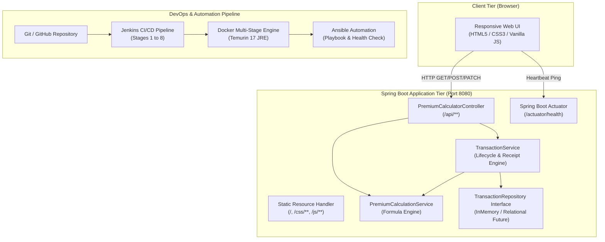

# System Architecture & Technical Design — Premium Calculator

This document outlines the technical architecture, design patterns, component interactions, and deployment topology of the **Premium Calculator** application.

---

## 1. High-Level Architecture Overview

Premium Calculator is structured as a modern, decoupled three-tier architecture with integrated DevOps automation:

---

## 2. Component Breakdown

### 2.1 Presentation Layer (Frontend)
- **Static Assets**: Single-page application architecture served directly by Spring Boot from `src/main/resources/static/`.
- **Vanilla JavaScript**: Pure ES6+ without heavy JavaScript frameworks, ensuring fast initial load times and no client-side build complexity.
- **Responsive CSS**: Flexbox and CSS Grid layout adapting smoothly from 320px mobile screens to 4K displays.
- **Real-Time Actuator Monitor**: Background heartbeat polling `/actuator/health` to indicate backend connectivity.

### 2.2 Application Controller Layer (`com.premiumcalculator.controller`)
- **`PremiumCalculatorController`**:
  - Exposes RESTful endpoints conforming to HTTP standards (`POST`, `GET`, `PATCH`).
  - Strict input validation via Jakarta Bean Validation (`@Valid`, `@NotBlank`, `@DecimalMin`, `@DecimalMax`, `@Min`, `@Max`).
  - Standardized JSON responses for calculation objects and error envelopes.

### 2.3 Business Logic & Calculation Layer (`com.premiumcalculator.service`)
- **`PremiumCalculationService`**:
  - Core mathematical engine for illustrative insurance calculations.
  - Implements high-precision `BigDecimal` arithmetic with `RoundingMode.HALF_UP` to prevent floating-point discrepancies.
  - Transparent formula:
    $$\text{Annual Premium} = \text{Coverage Amount} \times \text{Policy Rate}$$
    $$\text{Estimated Total Premium} = \text{Annual Premium} \times \text{Policy Term}$$
- **`TransactionService`**:
  - Manages the lifecycle and state transitions of transactions:
    $$\text{SUBMITTED} \longrightarrow \text{APPROVED} \quad \text{or} \quad \text{REJECTED}$$
  - Guard checks against invalid transitions (e.g. attempting to alter an already approved transaction).
  - Formats human-readable plain text receipts for customer voucher download.

### 2.4 Data Persistence Abstraction (`com.premiumcalculator.repository`)
- **`TransactionRepository` Interface**:
  - Encapsulates basic CRUD operations: `save`, `findById`, `findAll`, `existsById`, `deleteAll`.
- **`InMemoryTransactionRepository`**:
  - Thread-safe `ConcurrentHashMap` implementation for college practical execution.
  - Easily swappable with `JpaRepository` when migrating to PostgreSQL or MySQL without altering business services.

### 2.5 Centralized Exception Handling (`com.premiumcalculator.exception`)
- **`GlobalExceptionHandler`**:
  - Catches `MethodArgumentNotValidException`, `InvalidInputException`, `ResourceNotFoundException`, and `InvalidStatusTransitionException`.
  - Emits uniform `ErrorResponse` JSON with HTTP 400 Bad Request, 404 Not Found, or 500 Internal Server Error.

---

## 3. Policy Rate Matrix & Illustrative Calculations

| Policy Type | Illustrative Annual Rate | Min Coverage | Max Coverage | Valid Term Range | Example (₹1,00,000 for 5 Yrs) |
| :--- | :--- | :--- | :--- | :--- | :--- |
| **Life** | **1.20%** (`0.0120`) | ₹1,000 | ₹1,00,00,000 | 1 – 50 Years | Annual: ₹1,200 \| Total: ₹6,000 |
| **Health** | **2.40%** (`0.0240`) | ₹1,000 | ₹1,00,00,000 | 1 – 50 Years | Annual: ₹2,400 \| Total: ₹12,000 |
| **Vehicle** | **3.10%** (`0.0310`) | ₹1,000 | ₹1,00,00,000 | 1 – 50 Years | Annual: ₹3,100 \| Total: ₹15,500 |
| **Travel** | **1.60%** (`0.0160`) | ₹1,000 | ₹1,00,00,000 | 1 – 50 Years | Annual: ₹1,600 \| Total: ₹8,000 |

> **Disclaimer:** These rates and calculations are demonstration estimates created strictly for educational evaluation and do not represent real-world insurance underwriting.

---

## 4. Non-Functional & Security Attributes

1. **Precision & Accuracy**: All financial amounts use `java.math.BigDecimal` with scale 2 to guarantee currency integrity.
2. **Container Security**: Multi-stage Docker container runs under dedicated non-root user `appuser` (UID 1001).
3. **Observability**: Spring Boot Actuator exposes health status (`/actuator/health`) with structured logging throughout services.
4. **Resilience**: Actuator health checks in Docker (`HEALTHCHECK`), Jenkins pipeline (Stage 8), and Ansible deployment playbook guarantee zero unverified deployments.
