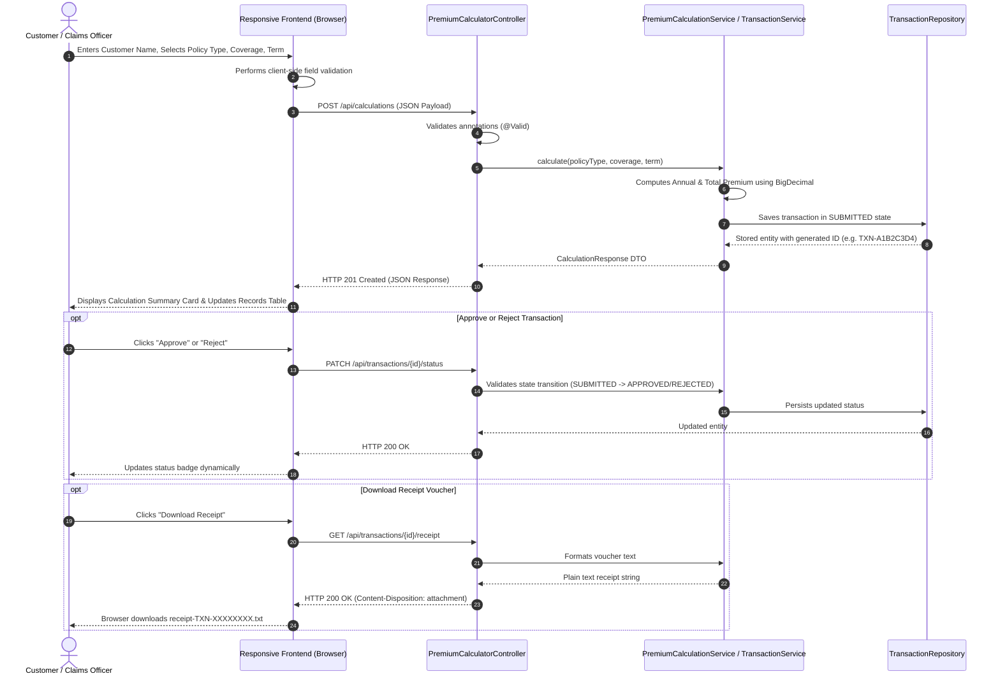

# COLLEGE PRACTICAL LABORATORY REPORT

---

## 1. Title / Cover Page

```
========================================================================================
                          DEPARTMENT OF COMPUTER ENGINEERING
                       DEV-OPS & SOFTWARE ENGINEERING LABORATORY
========================================================================================

                                 PRACTICAL PROJECT REPORT
                                            ON
                                   PREMIUM CALCULATOR
          (Full-Stack Application Development with End-to-End DevOps Lifecycle)

========================================================================================

SUBMITTED BY:
  Student Name  : Manas Chand
  Roll Number   : 23102C0030
  Academic Year : 2026 – 2027
  Operating Env : Windows 10/11 Professional (64-bit)

PROJECT ARTIFACTS:
  Repository    : premium-calculator
  Backend Stack : Java 17, Spring Boot 3.2.5, Maven 3.9+
  Frontend Stack: HTML5, Modern Responsive CSS3, Vanilla JavaScript (ES6+)
  DevOps Stack  : Git, GitHub, Docker, Jenkins CI/CD, Ansible, Spring Boot Actuator

========================================================================================
```

---

## 2. Aim and Objectives

### Aim:
To design, implement, test, containerize, and automate the continuous delivery and deployment of a full-stack insurance demonstration application named **Premium Calculator** using modern DevOps practices and tools.

### Objectives:
1. To develop a robust, responsive web interface allowing users to estimate policy premiums for four policy categories (Life, Health, Vehicle, Travel).
2. To build an enterprise-grade backend using Java 17 and Spring Boot following clean architecture, DTO patterns, and centralized exception handling.
3. To enforce rigorous automated testing comprising JUnit 5 unit testing, MockMvc integration testing, and Selenium browser automation.
4. To implement version control and collaborative branching strategies (`develop` workflow) using Git and GitHub.
5. To containerize the application using multi-stage Docker builds ensuring non-root security context and minimal image footprint.
6. To construct an automated 8-stage declarative Jenkins CI/CD pipeline verifying code quality, running tests, packaging JAR artifacts, and deploying containers.
7. To orchestrate container configuration management and zero-downtime deployment verification via Ansible playbooks.
8. To incorporate operational observability and health monitoring using Spring Boot Actuator.

---

## 3. Problem Statement

Calculating insurance premiums involves domain formulas that must balance computational accuracy, boundary validations, and auditability. In many academic and training contexts, software development is taught in silos—separating coding from automated testing, containerization, and deployment.

There is a critical need for a cohesive, real-world educational system that demonstrates the complete **Software Development Life Cycle (SDLC)**:
- Implementing strict financial precision without floating-point errors.
- Enforcing transparent estimation formulas alongside explicit academic disclaimers.
- Providing full automated regression safety nets before deployment.
- Eliminating manual deployment drift through reproducible Docker containers, Jenkins pipelines, and Ansible configuration management.

---

## 4. Software and Hardware Requirements

### 4.1 Software Requirements
| Component | Specification / Version |
| :--- | :--- |
| **Operating System** | Windows 10/11 (64-bit) / Linux (Ubuntu 22.04 LTS via WSL 2) |
| **Java Development Kit** | Oracle OpenJDK / Eclipse Temurin JDK 17 (or JDK 21 LTS) |
| **Build Tool** | Apache Maven 3.9+ / Maven Wrapper (`mvnw`, `mvnw.cmd`) |
| **Version Control** | Git 2.40+ and GitHub Remote Repository |
| **Container Engine** | Docker Engine 24+ / Docker Desktop for Windows |
| **CI/CD Server** | Jenkins Automation Server 2.440+ (Declarative Pipeline) |
| **Configuration Tool** | Ansible Core 2.15+ (executed via WSL 2 / Linux environment) |
| **Web Browser** | Google Chrome / Microsoft Edge / Mozilla Firefox |

### 4.2 Minimum Hardware Requirements
- **Processor:** Intel Core i5 / AMD Ryzen 5 or higher (x86_64 architecture).
- **RAM:** Minimum 8 GB (16 GB recommended for concurrent Docker and Jenkins execution).
- **Storage:** 10 GB available SSD space.
- **Network:** Broadband connection for pulling Maven artifacts and Docker base images.

---

## 5. Technologies Used

- **Spring Boot 3.2.5**: Standalone Java enterprise application framework with embedded Tomcat server.
- **Jakarta Bean Validation**: Declarative input validation for HTTP request payloads.
- **Spring Boot Actuator**: Production-ready operational monitoring endpoints (`/actuator/health`).
- **HTML5 & Modern CSS3**: Semantically rich, mobile-first responsive presentation layer without heavy framework bloat.
- **Vanilla JavaScript (ES6+)**: Asynchronous client-side state handling, dynamic DOM updates, and REST API communication (`fetch`).
- **JUnit 5 & Mockito**: Automated unit testing, parameterized calculations, and mock service boundaries.
- **Selenium WebDriver**: Automated browser functional testing for end-to-end user journeys.
- **Docker**: Multi-stage Linux container packaging for immutable application environments.
- **Jenkins**: Continuous integration and delivery server executing scripted quality gates.
- **Ansible**: Agentless infrastructure automation for container provisioning and health verification.

---

## 6. System Architecture

The Premium Calculator architecture follows a decoupled, layered design ensuring separation of concerns:

```
[ Web Browser / Client ]
       │  HTTP / JSON / Text
       ▼
[ Spring Boot Web Layer: Embedded Tomcat (Port 8080) ]
   ├── Static Resource Controller (index.html, style.css, app.js)
   ├── REST Controller (PremiumCalculatorController)
   └── Actuator Health Endpoint (/actuator/health)
       │
       ▼
[ Service & Domain Logic Layer ]
   ├── PremiumCalculationService (BigDecimal Precision Engine)
   └── TransactionService (Lifecycle, Status State Machine, Receipt Generator)
       │
       ▼
[ Persistence Abstraction Layer ]
   └── TransactionRepository Interface ◄─── InMemoryTransactionRepository (ConcurrentHashMap)
                                       (Future: JpaTransactionRepository -> Relational DB)
```

---

## 7. Application Workflow



---

## 8. Premium Calculation Formula

All rates are illustrative demonstration estimates for educational evaluation.

### Rate Schedule:
- **Life Insurance:** $1.20\%$ ($0.0120$)
- **Health Insurance:** $2.40\%$ ($0.0240$)
- **Vehicle Insurance:** $3.10\%$ ($0.0310$)
- **Travel Insurance:** $1.60\%$ ($0.0160$)

### Mathematical Equations:
$$\text{Annual Premium} = \text{Coverage Amount} \times \text{Policy Rate}$$

$$\text{Estimated Total Premium} = \text{Annual Premium} \times \text{Policy Term (Years)}$$

### Precision & Rounding Rules:
- Implemented strictly with `java.math.BigDecimal`.
- Calculation results are rounded to two decimal places ($2$) using `RoundingMode.HALF_UP` to prevent standard binary floating-point representation drift.
- Boundary conditions: Coverage $\in [\text{₹}1,000, \text{₹}10,000,000]$; Term $\in [1, 50\text{ years}]$.

---

## 9. API Endpoint Summary

| HTTP Method | Endpoint URI | Description | Request Body | Success Response | Error Codes |
| :--- | :--- | :--- | :--- | :--- | :--- |
| `POST` | `/api/calculations` | Calculates estimate and records transaction | `CalculationRequest` (JSON) | `201 Created` (`CalculationResponse`) | `400 Bad Request` |
| `GET` | `/api/transactions` | Lists all transactions (latest first) | None | `200 OK` (`Array<CalculationResponse>`) | `500 Server Error` |
| `GET` | `/api/transactions/{id}` | Retrieves a single transaction by ID | None | `200 OK` (`CalculationResponse`) | `404 Not Found` |
| `PATCH` | `/api/transactions/{id}/status` | Approves or rejects a submitted transaction | `StatusUpdateRequest` (JSON) | `200 OK` (`CalculationResponse`) | `400 Bad Request`, `404 Not Found` |
| `GET` | `/api/transactions/{id}/receipt` | Downloads plain text voucher attachment | None | `200 OK` (`text/plain`) | `404 Not Found` |
| `GET` | `/actuator/health` | Application health monitoring check | None | `200 OK` (`{"status":"UP"}`) | `503 Service Unavailable` |

---

## 10. Git and GitHub Workflow

- **Branching Model:** GitFlow `develop` workflow.
  - `main`: Release production branch.
  - `develop`: Ongoing integration and CI testing branch.
  - `feature/*`: Short-lived feature branches merged via Pull Requests.
- **Commit Convention:** Conventional Commits (`feat:`, `fix:`, `test:`, `docs:`, `ci:`, `chore:`).
- **Issue Templates:** Configured in `.github/ISSUE_TEMPLATE/` for structured bug reporting and feature tracking.
- **Security:** Strict `.gitignore` prevents compiling class files, logs, packaged JARs, or local credentials into source history.

---

## 11. Automated Testing Strategy

A multi-tiered testing strategy was adopted:
1. **Unit Testing (JUnit 5 & Mockito):**
   - 14 tests in `PremiumCalculationServiceTest`: verifies mathematical precision across all policy categories, parameterized tests, and boundary value rejections.
   - 9 tests in `TransactionServiceTest`: verifies transaction creation, unique ID allocation, state machine validation rules, and receipt formatting.
2. **REST API Integration Testing (Spring Boot Test & MockMvc):**
   - 10 tests in `PremiumCalculatorControllerIntegrationTest`: spins up an application context and validates real HTTP requests, status codes, payload validations, error envelopes, and Actuator endpoints.
3. **End-to-End Functional Testing (Selenium WebDriver):**
   - `PremiumCalculatorSeleniumTest`: automates headless Chrome to simulate form input, estimate calculation display, and DOM element verification. Configured under a separate Maven profile (`-Pselenium-tests`) for environment independence.

### Test Execution Results (Verified in Terminal):
```
[INFO] -------------------------------------------------------
[INFO]  T E S T S
[INFO] -------------------------------------------------------
[INFO] Running com.premiumcalculator.controller.PremiumCalculatorControllerIntegrationTest
[INFO] Tests run: 10, Failures: 0, Errors: 0, Skipped: 0
[INFO] Running com.premiumcalculator.service.PremiumCalculationServiceTest
[INFO] Tests run: 14, Failures: 0, Errors: 0, Skipped: 0
[INFO] Running com.premiumcalculator.service.TransactionServiceTest
[INFO] Tests run: 9, Failures: 0, Errors: 0, Skipped: 0
[INFO] 
[INFO] Results:
[INFO] Tests run: 33, Failures: 0, Errors: 0, Skipped: 0
[INFO] ------------------------------------------------------------------------
[INFO] BUILD SUCCESS
[INFO] ------------------------------------------------------------------------
```

---

## 12. Docker Implementation

- **Multi-Stage Architecture:**
  - **Stage 1 (`builder`):** `eclipse-temurin:17-jdk-jammy`. Copies Maven wrapper and compiles the application into an executable Spring Boot fat JAR.
  - **Stage 2 (`runtime`):** `eclipse-temurin:17-jre-jammy`. Creates a non-root group (`appgroup`, GID 1001) and user (`appuser`, UID 1001). Copies solely the generated JAR.
- **Container Health Check:**
  `HEALTHCHECK --interval=30s --timeout=5s --start-period=30s --retries=3 CMD curl -f http://localhost:8080/actuator/health || exit 1`
- **Docker Compose:** Provided in `docker-compose.yml` defining memory limits (768MB limit / 256MB reservation) and automatic restart policies.

---

## 13. Jenkins CI/CD Pipeline

The declarative `Jenkinsfile` orchestrates 8 distinct automated stages:
1. **Checkout:** Checks out the designated Git branch.
2. **Verify Java & Maven:** Verifies JDK and Maven wrapper versions (using `bat` on Windows or `sh` on Linux).
3. **Run Tests:** Executes `./mvnw clean test` and records Surefire test reports. Fails pipeline if any test fails.
4. **Package Application:** Packages executable JAR with `./mvnw package -DskipTests`.
5. **Archive Artifact:** Stores the verified JAR artifact in Jenkins build history.
6. **Build Docker Image:** Builds `premium-calculator:latest` from the multi-stage Dockerfile.
7. **Deploy Container:** Restarts container gracefully with port binding `8080:8080` (conditional on `main` or `develop` branches).
8. **Verify Health:** Polls `http://localhost:8080/actuator/health` to confirm the containerized application is running and responding with `UP`.

---

## 14. Ansible Deployment

Ansible manages deployment idempotently:
- **`inventory.ini`**: Maps target application servers (supports localhost / WSL / remote VMs).
- **`vars/main.yml`**: Defines image names, port mappings, and health check retry parameters.
- **`playbook.yml`**:
  - Ensures Docker daemon is active.
  - Checks image availability.
  - Manages container state using `community.docker.docker_container`.
  - Uses `ansible.builtin.uri` to poll `/actuator/health` until HTTP 200 `UP` is verified.
- **Execution Environment:** Documented for native Linux execution and Windows 10/11 via WSL 2.

---

## 15. Monitoring and Health Checks

- **Actuator Endpoint:** `GET /actuator/health` exposed for automated health monitoring.
- **Frontend Integration:** A live heartbeat component runs in the web interface, polling the backend every 30 seconds and displaying a real-time status indicator (`Backend: UP`).
- **Structured Logging:** SLF4J with Logback formats log messages with timestamps, thread names, log levels, and contextual transaction IDs.

---

## 16. Expected Outputs

1. **Web Interface:** Accessible at `http://localhost:8080` featuring interactive inputs, rate cards, and live calculation summaries.
2. **Transaction Persistence:** Records listed in the transactions table with status badges (`SUBMITTED`, `APPROVED`, `REJECTED`).
3. **Receipt Voucher:** Text file download formatted with customer details, rate percentages, total sums, and educational disclaimers.
4. **Docker Container:** Verified running with `docker ps` exhibiting healthy status on port 8080.
5. **Test Report:** 33 passing automated tests without regression.

---

## 17. Results and Conclusion

The **Premium Calculator** project was successfully developed, tested, and integrated with an end-to-end DevOps automation suite. All calculation rules, boundary validations, REST endpoints, UI interactions, and state transitions function as intended. 

Through this project:
- A responsive full-stack application was built demonstrating mathematical precision and robust error handling.
- Continuous Integration was established using Maven and Jenkins to ensure zero regression before packaging.
- Continuous Delivery and Configuration Management were automated through multi-stage Docker containerization and Ansible orchestration.
- Operational reliability was guaranteed via Actuator monitoring and integrated health checks.

The project fulfills all requirements of a comprehensive software engineering and DevOps college practical.

---

## 18. Limitations and Future Enhancements

### Limitations in Version 1.0.0:
1. **In-Memory Storage:** Transactions are stored in a thread-safe `ConcurrentHashMap`. Server restarts reset stored transactions.
2. **Authentication:** The current version provides open access without individual user authentication or role-based logins.

### Future Enhancements:
1. **Persistent Database:** Migrate `InMemoryTransactionRepository` to Spring Data JPA connected to PostgreSQL or MySQL.
2. **Security & Authentication:** Implement Spring Security with JWT tokens for multi-tenant customer and claims officer roles.
3. **Kubernetes Deployment:** Construct Helm charts and Horizontal Pod Autoscaler (HPA) manifests for Kubernetes clustering.
4. **Cloud Telemetry:** Export Micrometer metrics to Prometheus and visualize traffic on Grafana dashboards.

---

## 19. Practical Task Mapping (Tasks 1 to 15)

| Practical Task | Lifecyle Area | Primary Implementation Files | Verification Evidence |
| :---: | :--- | :--- | :--- |
| **Task 1** | Requirements & Architecture | `ARCHITECTURE.md`, `BACKLOG.md` | Architecture diagram & Rate schedule |
| **Task 2** | Git & Repository Initialization | `.gitignore`, `README.md` | Initial commit hash & repo structure |
| **Task 3** | Branching Strategy | `CONTRIBUTING.md`, `develop` branch | Git log showing branch and commit convention |
| **Task 4** | Project Scaffolding | `pom.xml`, `application.properties` | Maven dependency tree & JDK 17 setup |
| **Task 5** | Core Calculation Logic | `PremiumCalculationService.java` | Calculation formula implementation |
| **Task 6** | DTOs & Bean Validation | `CalculationRequest.java`, `ErrorResponse.java` | Validation constraints & error envelope |
| **Task 7** | REST API & Exception Handling | `PremiumCalculatorController.java`, `GlobalExceptionHandler.java` | Postman/cURL JSON responses & status codes |
| **Task 8** | Persistence & Receipt Service | `InMemoryTransactionRepository.java`, `TransactionService.java` | Downloaded text receipt file |
| **Task 9** | Frontend Web Development | `index.html`, `style.css`, `app.js` | Browser screenshot of responsive UI |
| **Task 10**| Automated Unit & Integration Tests| `*Test.java` (33 test cases) | Surefire test report (33 Passed, 0 Failed) |
| **Task 11**| E2E Selenium Testing | `PremiumCalculatorSeleniumTest.java` | Selenium headless test execution logs |
| **Task 12**| Multi-stage Dockerization | `Dockerfile`, `docker-compose.yml` | `docker images` & `docker ps (healthy)` |
| **Task 13**| Jenkins CI/CD Pipeline | `Jenkinsfile` | Jenkins 8-stage pipeline visualization |
| **Task 14**| Ansible Configuration Playbook | `ansible/playbook.yml`, `inventory.ini` | Ansible execution output (`failed=0`) |
| **Task 15**| Monitoring & Operational Health| `/actuator/health`, `app.js` heartbeat | Actuator JSON output & UI health badge |

---

## 20. Checklist of Screenshots / Evidence to Capture

To submit this practical project to your college faculty, capture the following screenshots and evidence:

- [ ] **Evidence 1:** Source code tree in IDE (showing `src/main/java`, `src/main/resources`, `ansible`, `docs`, `Jenkinsfile`, `Dockerfile`).
- [ ] **Evidence 2:** Application Web UI (`http://localhost:8080`) showing customer input, selected policy type, and coverage amount.
- [ ] **Evidence 3:** Calculation summary card displayed with calculated annual and total premiums.
- [ ] **Evidence 4:** Transaction table showing entries with status badges (`SUBMITTED`, `APPROVED`, `REJECTED`).
- [ ] **Evidence 5:** Transaction Details popup modal with action buttons.
- [ ] **Evidence 6:** Downloaded text receipt (`receipt-TXN-XXXXXXXX.txt`) opened in Notepad.
- [ ] **Evidence 7:** Validation error message in browser when submitting invalid input (e.g. blank name or ₹500 coverage).
- [ ] **Evidence 8:** Terminal output executing `./mvnw.cmd test` showing **Tests run: 33, Failures: 0, Errors: 0, Skipped: 0** and `BUILD SUCCESS`.
- [ ] **Evidence 9:** Generated JAR file in `target/` directory (`premium-calculator-1.0.0.jar`).
- [ ] **Evidence 10:** Docker build output: `docker build -t premium-calculator:latest .`.
- [ ] **Evidence 11:** Terminal output of `docker ps` showing container running and marked `healthy`.
- [ ] **Evidence 12:** Browser or cURL view of `http://localhost:8080/actuator/health` showing `{"status":"UP"}`.
- [ ] **Evidence 13:** Jenkins pipeline execution view showing all 8 green pipeline stages.
- [ ] **Evidence 14:** Ansible playbook execution in WSL/Linux showing successful task completion.
- [ ] **Evidence 15:** GitHub repository web view showing commit history, branches (`main`, `develop`), and README.
